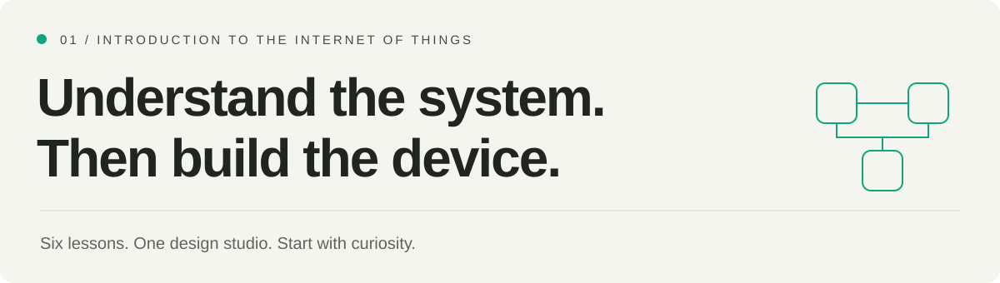

# Introduction to IoT

[← Main roadmap](../README.md) · [Start lesson 01 →](lessons/01-things-and-systems.md) · [Design workbook](workbook.md) · [Sources](references.md)

**A practical first course in connected systems.** Learn how physical measurements become useful information, how commands reach devices, and how to design for the moments when a connection fails.

<table>
<tr>
<td width="50%" valign="top"> <strong>Start with the physical world.</strong> A real breadboard prototype: components, connections, and a controller.</td>
<td width="50%" valign="top"> <strong>Understand the whole system.</strong> A development board is one part of the path from sensing to a useful application.</td>
</tr>
</table>

Photographs: Dolicom (CC BY-SA 3.0) and Ubahnverleih (CC0). [Source pages, licenses, and APA photo references](../assets/VISUALS.md). The breadboard photograph is an example of prototyping, not the wiring plan for this course.

---

## Before you begin

| What you need | What you will produce |
| --- | --- |
| No previous IoT experience | An explained system architecture |
| A text editor or notebook | A message contract and failure plan |
| Basic arithmetic; a calculator is fine | Five measurable requirements and a tradeoff decision |
| No hardware or paid account required | An initial risk register, data inventory, and bill of materials |

**Our running example:** a room monitor that samples temperature, shows a local status, and sends readings to a dashboard. An optional LED lets us discuss commands without introducing a mains-powered appliance. All sample values, thresholds, and timings in these lessons are teaching choices, not universal IoT requirements.

This module is a **design and reasoning lab**. Its paper exercises do not establish hardware accuracy, battery life, security, or reliability. Later modules teach you how to implement and measure those properties.

## Your learning path

| Lesson | Learn | Make |
| --- | --- | --- |
| [01 · Things and systems](lessons/01-things-and-systems.md) | Sensors, controllers, actuators, and user needs | A component map and a use-case statement |
| [02 · A reading's journey](lessons/02-data-and-commands.md) | Telemetry, events, commands, configuration, and state | A message contract and a timeline |
| [03 · Connections and failure](lessons/03-architecture-and-failure.md) | Direct, gateway, and device-to-device designs | Two architectures and an outage table |
| [04 · Requirements and tradeoffs](lessons/04-requirements-and-tradeoffs.md) | Measurable goals, latency, data volume, and resource budgets | Five requirements and a justified choice |
| [05 · Trust and lifecycle](lessons/05-security-privacy-and-lifecycle.md) | Identity, permissions, privacy, support, and retirement | A small threat model and data inventory |
| [06 · Design studio](lessons/06-design-studio.md) | Combine the lessons into one reviewable design | A completed design dossier |

### A useful study rhythm

**Read → work the example → try it yourself → check your reasoning.**

Read the explanation before opening each answer panel. Add the exercise result to your [workbook](workbook.md). Revise earlier answers when a later lesson exposes a missing assumption.

The course uses IoT architecture concepts from the [International Telecommunication Union (2012)](references.md#ref-itu). The room-monitor scenario and exercises are original teaching material for this repository.

## What you should be able to explain

- [ ] Trace a measurement through sensing, conditioning, firmware, networking, storage, and an application.
- [ ] Explain which components are optional and why an actuator is not needed in every IoT system.
- [ ] Distinguish a request, an accepted command, a reported output, and a measured physical effect.
- [ ] Compare two architectures and explain failures at each link.
- [ ] Write measurable limits for accuracy, latency, freshness, cost, power, retention, and support.
- [ ] Identify trust boundaries, sensitive data, physical-access risks, and lifecycle responsibilities.

## Finish with evidence

Submit your completed workbook, diagram, and decision notes. Use the [worked design](examples/room-monitor-design.md) to compare reasoning, then complete the [assessment](assessment.md).

| Completion check | Evidence |
| --- | --- |
| You can explain the whole system | Diagram with labeled arrows and optional components |
| Your claims can be tested | Five requirements with units, conditions, and verification methods |
| You have considered failures | Outage behavior, stale-data handling, and command outcomes |
| Your design has boundaries | Risk list, permissions, data inventory, and support plan |
| Your choice has a reason | Comparison of two architectures against the same needs |

Keep corrections and unresolved questions alongside your first draft. **Completing this folder means your design can be reviewed; it does not mean the device has been built or tested.**

---

[Begin lesson 01 →](lessons/01-things-and-systems.md) · [Open the workbook](workbook.md) · [Next category: Electronics Fundamentals →](../02-electronics-fundamentals/README.md)
