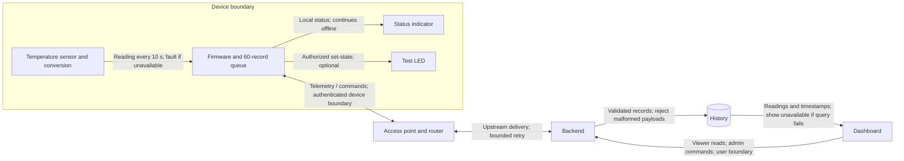

# Worked design · A room monitor

[← Module home](../README.md) · [Workbook](../workbook.md) · [Design studio](../lessons/06-design-studio.md)

**Status: illustrative design, not an implemented or tested device.** The targets below are chosen for teaching. Read this after your first workbook attempt.

## 1 · Purpose and scope

For a room occupant, measure temperature so they can review recent trends and investigate persistent warmth. The device does not identify occupants, diagnose indoor-air quality, or control a heater.

A local status indicator shows whether sensing is functioning. A separate optional test LED can accept a remote set-state command.

## 2 · Architecture

The diagram is an original design illustration. Sensor conversion is combined with the sensor role; no dedicated gateway is proposed. A router forwards traffic, while an application gateway would perform an additional application-level role.

| Path | Frequency and failure policy |
| --- | --- |
| Sensor → firmware | Every 10 s; report invalid status on failure |
| Firmware → backend | One scheduled reading every 10 s; queue while unavailable |
| Backend → storage | Per accepted unique reading; surface write failures rather than claim persistence |
| Storage → dashboard | Refresh once per second; show data age and service errors |
| Dashboard → backend → device | On an authorized command; expire requests after 30 s |
| Firmware → local indicators | On state changes; keep sensor-status behavior independent of upload |

## 3 · Requirements

| ID | Target | Future check |
| --- | --- | --- |
| R1 | Powered sample intervals remain between 9 and 11 s during a 30-minute run | Inspect device timestamps |
| R2 | At least 95 of 100 valid samples display within 5 s on the defined test network | Compare synchronized acquisition/display times |
| R3 | Mark age greater than 30 s stale within the next 1 s display refresh | Stop delivery and observe |
| R4 | During a 10-minute outage, preserve R1 and cap the queue at 60 | Inspect logs and maximum queue occupancy |
| R5 | Retain seven days; daily cleanup removes older records within 24 h | Seed old records and run cleanup |

**Candidate constraints:** mains-independent low-voltage USB power; no battery-runtime claim; initial temperature-error target ±1 °C over 20–35 °C, unverified until a reference and comparison method are selected; a proposed 99% valid-sample fraction during a 24-hour powered test; a teaching budget ceiling of PHP 2,000 excluding an existing computer/router, subject to actual quotations; and a learner-owned support plan for one academic term.

These are proposed constraints, not verified performance, a purchase recommendation, or a claim that the budget is sufficient. Include the reference instrument's uncertainty in an eventual accuracy evaluation.

## 4 · Message and buffering policies

Each sample contains schema version, device ID, boot ID, sequence, sample time, temperature in Celsius, and quality. The backend assigns reception time. An invalid sample uses a null temperature and explicit quality such as `sensor_fault`.

Store one record per device/boot/sequence combination. Historical replay must not replace a newer reading as the live display. Uncertain device time remains explicitly labeled; reception time cannot prove when an offline measurement happened.

Queue overflow drops the oldest record and increments a drop counter. Queue storage is RAM in this design, so reboot loses queued readings. On restart, use a new boot ID, restart sequence numbering, and mark time uncertain until synchronized.

After reconnection, allow at most two replayed records per second in addition to the normal sample stream. This is a proposed limit; actual service capacity still requires testing.

## 5 · Architecture decision

| Need | Direct backend | Local gateway |
| --- | --- | --- |
| One network-capable device | Suitable candidate | Adds a component |
| Local sensor status during upstream loss | Implement on device | Still implement on device |
| Short backlog | Device queue | Gateway could store more |
| Several incompatible device interfaces | May need redesign | Gateway may help bridge them |

Choose direct-to-backend for this one-room exercise to reduce the number of managed components. Reconsider a gateway if device interfaces, local coordination, or storage requirements change. “Simpler” here means fewer separately managed components, not proven lower cost or higher reliability.

## 6 · Trust and lifecycle notes

The device can submit only its own readings. Viewers can read history; administrators may change settings or send test commands. Credentials are separate per device, kept out of source control, and revocable.

| Risk | Control proposal | Later evidence |
| --- | --- | --- |
| Copied device credential | Selective credential revocation | Revoked identity cannot publish |
| Unauthorized configuration | Admin-only setting changes | Viewer request denied |
| Physical debug access | Assess connector exposure and debug configuration | Document interfaces and chosen protections |

Retain only pseudonymous device IDs, temperature, quality, and necessary timestamps. Limit diagnostics and omit credentials. The learner owns installation, update planning, recovery documentation, and retirement. Retirement revokes access and deletes data according to the stated policy.

## 7 · Initial materials and costs

Plan one controller board, one compatible temperature sensor, a breadboard, suitable wires/passives, status indication, low-voltage power, and mounting/enclosure materials. Use existing network and computing resources if appropriate.

Exact models, pin compatibility, electrical ratings, quotes, hosting charges, and replacement costs remain unresolved. The next electronics lessons should resolve these before assembly. Do not count existing equipment as universally free.

## 8 · Tabletop answer guide

1. **15-minute outage:** with exactly 90 scheduled samples and an initially empty 60-record queue, retain 60 and drop 30. Boundary timing and replay are excluded from this simplified count.
2. **Delayed sample:** insert into history by sample identity and time; do not label it current merely because it just arrived.
3. **Sensor fault:** local status shows fault; the application displays invalid status when the fault arrives, or stale status if it cannot arrive.
4. **Repeated command:** repeated set-on converges to the same target; toggle can reverse the output. An expired command is rejected. Check expiry only against a usable time basis; this design rejects remote commands while time is uncertain.
5. **Restart:** generate a new boot ID, reset sequence, lose the RAM queue, and label time uncertainty. Reinitialize outputs to their documented startup state.
6. **Viewer configuration request:** reject it; authentication as a viewer does not grant admin permissions.

**Unresolved before implementation:** exact parts, calibration method, time synchronization, credential provisioning, supported update/recovery mechanism, and measured power/latency.

[Review your workbook](../workbook.md) · [Take the assessment →](../assessment.md)
