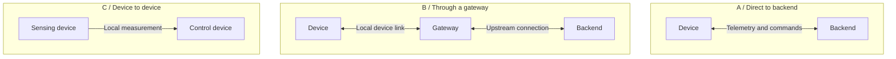

# 03 · Connections and failure

[← Data and commands](02-data-and-commands.md) · **Lesson 3 of 6** · [Next: Requirements and tradeoffs →](04-requirements-and-tradeoffs.md)

> **Learning goal:** compare three connection patterns and assign responsibilities during an outage.

## Architecture is a set of responsibilities

A diagram becomes useful when it answers: **Who does the work? What crosses each connection? What happens if that connection disappears?**

Begin with the physical path and add only the components your use case needs. Distributed processing can place work near devices rather than exclusively in a remote service; the NIST fog-computing model explains this relationship between devices, nearby resources, and cloud services ([Iorga et al., 2018](../references.md#ref-edge)).

## Compare three patterns

*Original teaching diagram. Arrows show logical communication, not a complete wiring or network schematic.*

**Direct to backend:** the device communicates with the service itself. There can still be an access point and router in between. “Direct” means no dedicated application gateway is required; it does not mean no network equipment exists.

**Through a gateway:** a local computer collects device messages, translates an interface, buffers readings, or runs local rules. This introduces another component to power, configure, secure, and maintain.

**Device to device:** a sensing device exchanges information with a nearby control device. If the remote dashboard is optional, local operation can remain useful without it. The peer link can still fail, so define how the receiving device detects old data.

These are alternatives for organizing a system. A real installation can combine them.

## Local, edge, and remote

For our room monitor, assign work explicitly:

| Responsibility | Suggested location in this example | Reason |
| --- | --- | --- |
| Read the temperature sensor | Device | It is physically attached there |
| Detect sensor communication errors | Device | Local status should not wait for a server |
| Drive the indicator LED | Device | The output remains under local control |
| Keep a short upload backlog | Device or gateway | Decide where memory and persistence are available |
| Store long-term history | Backend | Central access is useful for the dashboard |
| Display chart and data age | Application | The user needs both value and context |

“Local” does not automatically mean safe or reliable. A device can reset or run out of storage. Local responsibilities must have defined failure behavior too.

## Walk through an outage

Assume one reading every 10 seconds, a queue capacity of 60 readings, and a policy of dropping the oldest queued reading when full.

A 15-minute outage contains `900 / 10 = 90` scheduled readings. If the queue starts empty and all readings are produced, it can retain the most recent 60; 30 are dropped. This is an intentionally simplified model. It excludes timestamps at the interval boundary and any samples produced during later replay.

Upon reconnection, do not send unlimited backlog traffic. Specify a replay limit and count new incoming readings as well. Document whether the queue survives a power cycle; RAM alone does not.

| Failure | Local behavior | Remote behavior |
| --- | --- | --- |
| Device loses its network | Keep sensing; use bounded queue | Dashboard eventually marks data stale |
| Gateway stops | Devices follow their own local policy | Gateway path stops delivering |
| Backend stops accepting data | Retry at a bounded rate | Display should not claim healthy ingestion |
| Sensor stops responding | Mark measurements invalid | Do not present the old value as a new sample |
| Device loses power | No sensing while off | Show missing data; do not invent readings |

## Draw trust boundaries

A **trust boundary** is a point where data or authority crosses between differently trusted participants. Mark the device-to-service connection and the browser-to-service connection. Ask which identity is checked at each crossing and which actions are allowed.

Network location alone does not establish identity. Lesson 5 turns these questions into a small risk register.

## Try it yourself

Draw both direct and gateway versions of your use case in workbook section C. Label every arrow with message type, direction, frequency, and failure behavior. Mark the network equipment separately from an optional application gateway.

Choose where buffering lives. Specify queue capacity, overflow behavior, and what survives restart.

## Check your reasoning

**Question:** A gateway buffers readings during an internet outage. Does this guarantee that local sensing continues?

Reveal the explanation

No. The sensing device must itself continue operating without the gateway's upstream service. If firmware blocks while waiting for an upload or requires a remote response before the next sample, gateway storage cannot fix that behavior.

A gateway also does not recover readings that were never measured or never reached it.

**Keep:** both architectures, trust boundaries, and an outage table.  
[Next: Requirements and tradeoffs →](04-requirements-and-tradeoffs.md)
