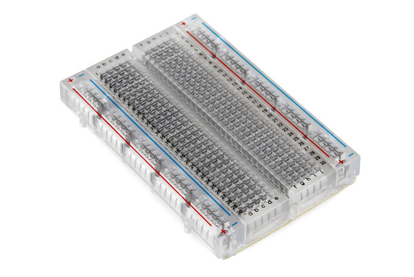
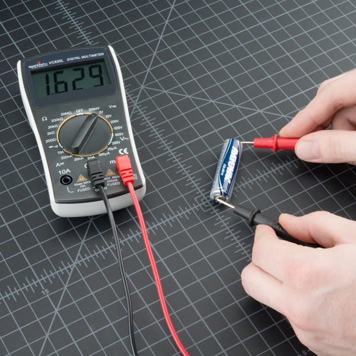

# Electronics Fundamentals

[Start lesson 01](lessons/01-electricity-and-safe-setup.md) · [Lab workbook](workbook.md) · [Assessment](assessment.md) · [References](references.md)

**Build a circuit, predict its behavior, and prove it with measurements.** Nine lessons and three labs introduce the electrical foundation of a room monitor: an LED, a button, and an analog sensor input.

<table><tr>
<td width="50%"> <strong>Understand the connections.</strong></td>
<td width="50%"> <strong>Measure before guessing.</strong></td>
</tr></table>

Real photographs: SparkFun Electronics, CC BY-SA 4.0. [Photo credits and original sources](assets/README.md). These illustrate equipment, not completed course experiments.

## Your learning path

| Lesson | Learn | Evidence to keep |
| --- | --- | --- |
| [01 · Electricity and a safe setup](lessons/01-electricity-and-safe-setup.md) | Voltage, current, resistance, power, units | Current and power predictions |
| [02 · Circuit calculations](lessons/02-circuit-calculations.md) | Series/parallel, Kirchhoff's laws, dividers, tolerances | Solved circuit and worst-case bounds |
| [03 · Components and datasheets](lessons/03-components-and-datasheets.md) | Parts, polarity, ratings, LED resistor selection | Bill of materials |
| [04 · Schematics to breadboards](lessons/04-schematics-and-breadboards.md) | Nodes, rails, pinouts, grounding, solder joints | Schematic and wiring photograph |
| [05 · Measure and troubleshoot](lessons/05-measurement-and-troubleshooting.md) | Meter connections, scope/analyzer roles | Measurements and fault log |
| [06 · Digital inputs and logic](lessons/06-digital-inputs-and-logic.md) | Thresholds, pull-ups, level shifting, debounce | Button truth table |
| [07 · Reliable power](lessons/07-power-and-decoupling.md) | Decoupling, regulators, supply transients | Power budget and load test |
| [08 · Analog, ADCs, and PWM](lessons/08-analog-adc-and-pwm.md) | Resolution, references, RC filters, buffering | Analog input measurements |
| [09 · Drivers and integration](lessons/09-drivers-and-integration.md) | MOSFETs, inductive loads, flyback protection | Driver sketch and final review |

Read, calculate, attempt the exercise, then open its answer panel. Use the [workbook](workbook.md) for the three labs. Paper work is useful without hardware, but mark experiments **not yet measured** until you perform them.

## Equipment and working boundary

Use a regulated, current-limited 3.3 V supply, breadboard, jumper wires, multimeter and its manual, documented red LED, momentary button, 330 ohm / 1 kohm / 10 kohm resistors (1/4 W), and a 10 kohm potentiometer. Small 100 nF ceramic and 10–100 uF electrolytic capacitors rated above the supply support the power/filter exercises. A microcontroller, analog sensor, oscilloscope, logic analyzer, and motor driver are extensions.

Core labs use small-current 3.3 V DC circuits. Disconnect power before rewiring, verify polarity, and check actual component datasheets. Example specifications are teaching assumptions, not guaranteed ratings for your parts. Mains and high-energy battery work require appropriately supervised training.

[Back to roadmap](../README.md)

## Prerequisites

Category 01; study category 03 alongside the calculations.

## Topics to learn

- [ ] Use voltage, current, resistance, power, Ohm's law, Kirchhoff's laws, and series/parallel circuit calculations. Work with tolerances and worst-case component ratings.
- [ ] Recognize resistor, capacitor, diode, transistor, MOSFET, regulator, switch, and connector functions. Calculate an LED resistor and inspect dissipation.
- [ ] Read schematics, pinouts, and datasheets; assemble breadboards; understand polarity, common references, continuity, grounding, and solder joints.
- [ ] Distinguish analog signals from digital logic; verify input thresholds and voltage compatibility. Use pull-ups, pull-downs, level shifting, and debounce circuits.
- [ ] Learn decoupling, bulk capacitance, regulator headroom, supply transients, and the difference between a clean schematic and a reliable physical circuit.
- [ ] Study ADC resolution/reference voltage, PWM duty cycle, simple RC filters, and an introduction to op-amp buffering and signal conditioning.
- [ ] Drive LEDs, buzzers, and small low-voltage motors through suitable drivers. Account for inductive transients and flyback protection; do not power motors directly from GPIO.
- [ ] Use a multimeter for voltage, continuity, resistance, and correctly connected current measurement. Learn what a logic analyzer and oscilloscope reveal.
- [ ] Start with current-limited low-voltage supplies. Check device ratings before energizing circuits; reserve mains and high-energy battery work for appropriately supervised training.

## Hands-on work

1. Calculate and build an LED circuit; compare predicted and measured values with tolerances.
2. Wire a button and sensor, document all voltage levels, and reproduce the circuit from your own diagram.
3. Observe a supply or signal while switching a small load; explain any reset, noise, or unexpected reading.

## Completion evidence

- [ ] Submit a schematic, wiring photograph, bill of materials, calculations, and a measurement table.
- [ ] Diagnose a deliberately disconnected signal or incorrect pull-up using measurements rather than guesses.

Keep code, diagrams, measurements, and notes from these exercises with your project. Record failures and fixes, not just the successful demonstration.

