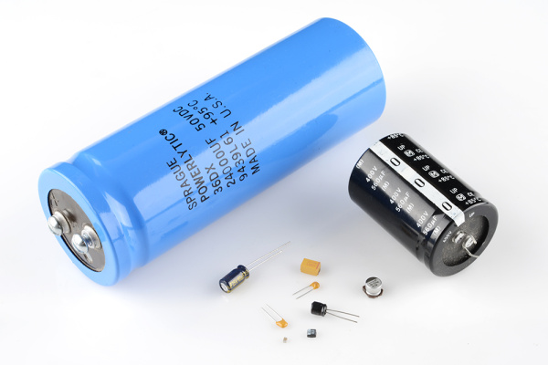

# 03 · Components and datasheets

[Previous](02-circuit-calculations.md) · [Module home](../README.md) · **Lesson 3 of 9** · [Next](04-schematics-and-breadboards.md)

**Goal:** identify parts and select values from operating requirements.

| Part | Function | Check before use |
| --- | --- | --- |
| Resistor | Limit current, divide voltage, bias inputs | Value, tolerance, power |
| Capacitor | Store charge, filter, support transients | Capacitance, voltage rating, polarity, ESR |
| Diode | Conduct primarily one way | Forward current/drop, reverse voltage, speed |
| LED | Emit light when forward biased | Polarity, forward voltage, allowed current |
| BJT | Amplify or switch current | Pinout, base drive, dissipation |
| MOSFET | Switch a load using gate voltage | Pinout, on-resistance at actual gate voltage, thermal limits |
| Regulator | Maintain a supply voltage | Input range, dropout, current, required capacitors |
| Switch / connector | Make or route connections | Contact arrangement, pin numbering, current rating |

Four-band resistor colors orange–orange–brown–gold encode `33 × 10 = 330 ohm ±5%`. Verify values with an unpowered, isolated measurement. SMD marking conventions differ.

## Read the datasheet

Find the exact part and package, then its pinout and viewing direction. Read recommended operating conditions, electrical characteristics and their test conditions, absolute maximum ratings, and application guidance. **Absolute maximum ratings are stress limits, not design targets.**

An LED's long lead often identifies the anode and a flat edge the cathode, but cut leads and unusual packages defeat this shortcut. Many aluminum electrolytics mark the negative terminal with a stripe; other capacitor types use different conventions. Confirm the actual part.



**Look for:** axial, radial, and surface-mount packages. Size alone does not establish capacitance or voltage rating. The large cans are identification references, not required lab parts. Photo: SparkFun Electronics, CC BY-SA 4.0; [credit](../assets/README.md).

## Choose an LED resistor

Assume a documented red LED has about 2.0 V forward drop at a few mA. With 3.3 V and a 4 mA target:

```text
R = (3.3 - 2.0) / 0.004 = 325 ohm; choose 330 ohm.
I = 1.3 / 330 = 3.94 mA
Resistor power = 1.3² / 330 = 5.12 mW
```

For an example supply range of 3.2–3.4 V, LED drop of 1.8–2.2 V, and resistor tolerance ±5%:

```text
Imax = (3.4 - 1.8) / (330 × 0.95) = 5.10 mA
Imin = (3.2 - 2.2) / (330 × 1.05) = 2.89 mA
Maximum resistor power = 1.6² / 313.5 = 8.17 mW
```

Check that your actual LED permits the maximum current. Its forward drop varies with current and temperature, so this is an approximate design model. Never connect a bare LED straight across a voltage supply.

## Try it yourself

Replace 330 ohm with 1 kohm while retaining the 2.0 V LED assumption. Predict current.

<details><summary>Check your reasoning</summary>

`I = 1.3 / 1000 = 1.3 mA`; the LED generally becomes dimmer. Measure resistor voltage to account for the actual LED drop.

</details>

**Keep:** exact parts and ratings in workbook section B. References: [SparkFun: Capacitors](https://learn.sparkfun.com/tutorials/capacitors), [TI: Interpreting Logic Datasheets](https://www.ti.com/lit/an/szza036b/szza036b.pdf).

[Next: Schematics to breadboards](04-schematics-and-breadboards.md)
