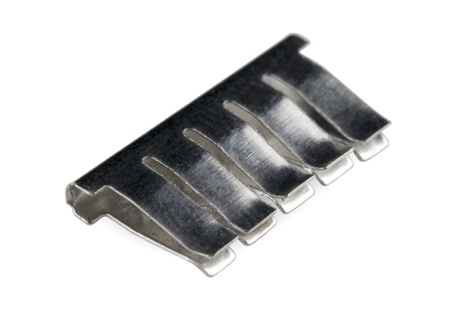

# 04 · Schematics to breadboards

[Previous](03-components-and-datasheets.md) · [Module home](../README.md) · **Lesson 4 of 9** · [Next](05-measurement-and-troubleshooting.md)

**Goal:** translate electrical nodes into physical connections and verify them unpowered.

A schematic describes connectivity, not physical position. Each uninterrupted connection is a **node**. R1, C1, and D1 identify components. Repeated net labels such as GND join the same electrical node. Junction dots normally indicate joined wires; inspect the drawing convention for crossings without dots.



**Look for:** five contacts formed from one metal strip. Leads inserted into that group share a node. Photo: SparkFun Electronics, CC BY-SA 4.0; [credit](../assets/README.md).

Many boards join A–E in each numbered row, with F–J separate across the trench. Power rails run lengthwise but may split halfway. Opposite rails are not automatically joined. Red and blue markings do not supply power.

Map your empty board using unpowered continuity checks. Check the central gap, rail midpoint, and opposite rails; do not assume the layout.

## Wire the LED by node

```text
Supply +3.3 V ---- R1 330 ohm ---- D1 anode
                                      LED
Supply GND ---------------------- D1 cathode
```

On a conventional A–E/F–J board, this example avoids power rails:

| Connection | Position |
| --- | --- |
| Supply positive | A5 |
| R1 | B5 to B10 |
| LED anode | C10 |
| LED cathode | C11 |
| Supply ground | A11 |

Use these positions only after confirming connectivity. Putting both resistor leads in the same connected group bypasses it. LED leads also need different nodes.

With power off, check intended connections and look for a direct supply short. A continuity buzzer has a model-dependent threshold; semiconductors affect readings, so a beep alone is not a complete diagnosis. Inspect polarity separately.

## Pinouts and permanent assembly

Header position, GPIO number, and software pin name can differ. Save the manufacturer's pinout and label the exact pins used. Connected non-isolated signals usually need a common ground reference. Do not join independent supply outputs merely because their nominal voltages match.

For soldered prototyping, inspect pad/lead wetting, bridges, and loose joints. A dull lead-free joint is not automatically defective. Confirm continuity and absence of shorts after assembly. Use ventilation, eye protection, and an iron stand. Successful breadboard operation does not prove the soldered copy is correct.

## Try it yourself

An LED is dark although one end of a power rail reads 3.3 V. How do you distinguish a split rail from a reversed LED?

<details><summary>Check your reasoning</summary>

Measure the local supply node relative to ground. Then power off and check rail continuity. A split rail lacks the intended connection; a reversed LED may have the correct local supply but no normal current. Check polarity before reconnecting.

</details>

**Keep:** schematic and your own wiring photograph. Reference: [SparkFun: Breadboards](https://learn.sparkfun.com/tutorials/how-to-use-a-breadboard).

[Next: Measure and troubleshoot](05-measurement-and-troubleshooting.md)
