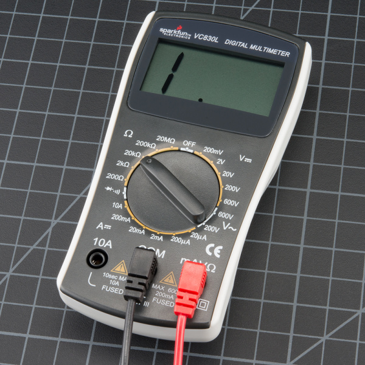

# 05 · Measure and troubleshoot

[Previous](04-schematics-and-breadboards.md) · [Module home](../README.md) · **Lesson 5 of 9** · [Next](06-digital-inputs-and-logic.md)

**Goal:** choose the correct meter connection and isolate faults with evidence.

**Look for:** COM, voltage/resistance, and current markings. This meter shares its small-current and voltage socket; yours may not. Its dial is in a resistance range in this photograph. Follow your own meter's manual. Photo: SparkFun Electronics, CC BY-SA 4.0; [credit](../assets/README.md).

| Mode | Circuit state | Connection |
| --- | --- | --- |
| DC voltage | Powered | Across two nodes |
| Resistance | Unpowered, capacitors discharged | Across an isolated resistor |
| Continuity | Unpowered, capacitors discharged | Across a connection |
| DC current | Power off while inserting meter, then on | In series using the correct fused socket and range |

For voltage, use COM and the voltage socket, select DC voltage, and choose a range above the expected reading if manual-ranging. A negative result normally indicates reversed probes. An overload display may mean an insufficient range; in resistance mode it may mean an open circuit.

**Never connect a meter in current mode across a supply.** Its low resistance can short the source. Read fuse, current, and time limits; avoid unfused high-current inputs for these labs. Power off before moving leads, and return to the voltage socket and mode after current measurements.

## Infer LED current from the resistor

Measure actual resistor resistance isolated and unpowered. Reconnect it, apply power, and measure its voltage drop. If `R = 328 ohm` and `VR = 1.28 V`, current is `1.28 / 328 = 3.90 mA`. Label this an inferred current. It avoids adding an ammeter's shunt resistance to the circuit.

Resolution is not accuracy: a 3.300 V display does not guarantee accuracy to 0.001 V. Read the meter's percentage-of-reading and count error terms.

## Diagnose one thing at a time

1. Record the exact symptom and expected result.
2. Measure local supply relative to local ground.
3. Measure resistor and LED drops; compare their sum to the supply.
4. Power off and inspect the suspect connection, value, or polarity.
5. Change one thing, repeat the measurements, and record the result.

Zero resistor voltage suggests little current, but does not establish its cause. Most supply voltage across the resistor could indicate a bypassed LED. Low local supply voltage could reflect current limiting or a bad connection.

A multimeter suits steady values. An **oscilloscope** shows voltage over time: short dips, ringing, and PWM. A **logic analyzer** captures interpreted digital levels and timing, not analog integrity. Set suitable sample rates and input thresholds. A bench oscilloscope ground clip is often earth-connected: attach it only to the intended compatible ground reference in these low-voltage circuits, and never defeat protective earth.

## Try it yourself

The LED is dark: local supply 3.3 V, resistor drop 0 V, LED drop 3.3 V. What next?

Check your reasoning

There is little branch current. Power off and check LED polarity, seating, and an open LED. These readings narrow the search but do not uniquely identify the fault.

**Keep:** lab 1 readings and a fault log. Reference: [SparkFun: Multimeters](https://learn.sparkfun.com/tutorials/how-to-use-a-multimeter).

[Next: Digital inputs and logic](06-digital-inputs-and-logic.md)
