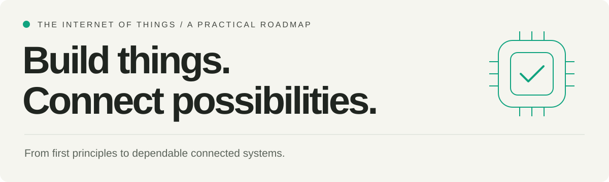
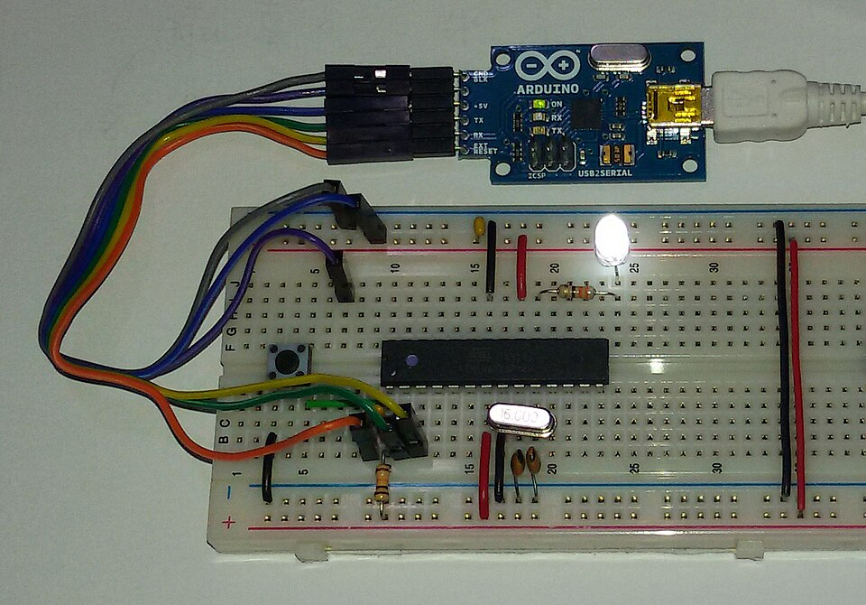
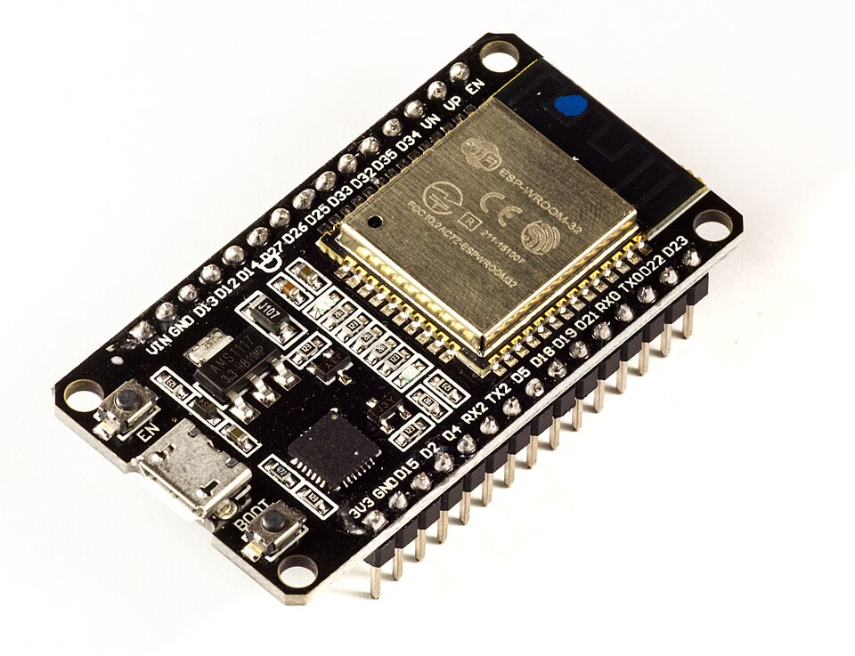
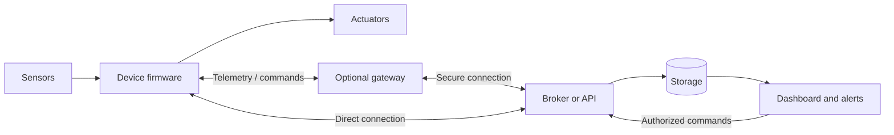
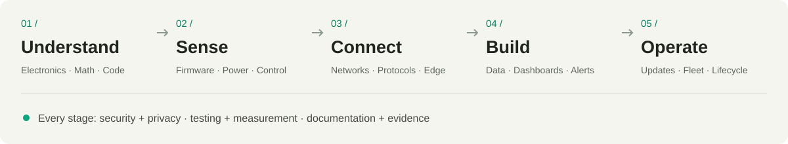

# Internet of Things Roadmap

  

  <a href="01-introduction-to-iot/README.md"><strong>Start learning →</strong></a>
  &nbsp;&nbsp; / &nbsp;&nbsp;
  <a href="#category-folders">Explore the curriculum</a>
  &nbsp;&nbsp; / &nbsp;&nbsp;
  <a href="#hands-on-practice">Build a project</a>
  &nbsp;&nbsp; / &nbsp;&nbsp;
  <a href="#references">Read the sources</a>

<table>
<tr>
<td width="50%"></td>
<td width="50%"></td>
</tr>
<tr>
<td><strong>01 / Start at the workbench</strong> Understand the hardware. Write the firmware. Measure what happens.</td>
<td><strong>02 / Connect it to the world</strong> Explore connected hardware. Integrate peripherals. Build networked devices.</td>
</tr>
</table>

Photographs: <a href="https://commons.wikimedia.org/wiki/File:Arduino_Breadboard_ATmega328P_USB2Serial.jpg">Dolicom</a> (<a href="https://creativecommons.org/licenses/by-sa/3.0/">CC BY-SA 3.0</a>) &amp; <a href="https://commons.wikimedia.org/wiki/File:ESP32_Espressif_ESP-WROOM-32_Dev_Board.jpg">Ubahnverleih</a> (<a href="https://creativecommons.org/publicdomain/zero/1.0/">CC0</a>) · <a href="assets/VISUALS.md">Photo credits &amp; APA references</a>

<table>
<tr>
<td width="33%" align="center"><h3>18</h3>Study guides Foundations → system engineering</td>
<td width="34%" align="center"><h3>04</h3>Project milestones Local sensing → reliable fleet</td>
<td width="33%" align="center"><h3>06</h3>Specialization paths Choose where to go deeper</td>
</tr>
</table>

---

## Overview

The Internet of Things (IoT) connects physical devices with software and communication networks so that measurements and actions can become part of a larger information system. Devices, connectivity, services, and applications work together, with security and management spanning the system ([International Telecommunication Union, 2012](#ref-itu)).

This roadmap is a practical curriculum for beginners, students, and developers moving into embedded and connected systems. It starts with electronics, mathematics, and C/C++, then progresses through firmware, networking, data processing, security, and deployment.

**The goal:** build a complete sensor-to-application system, explain its design decisions, and demonstrate how it behaves when something fails.

| Start here if… | Your next step |
| --- | --- |
| You are new to IoT | Read [Introduction to IoT](01-introduction-to-iot/README.md), then follow the study phases below. |
| You already write software | Check your electronics and measurement skills in [02](02-electronics-fundamentals/README.md) and [03](03-mathematical-foundations/README.md), then begin embedded work in [06](06-microcontrollers-and-embedded-systems/README.md). |
| You already have a prototype | Use [Projects and Assessment](18-projects-and-assessment/README.md) to identify missing tests and completion evidence. |
| You want to specialize | Complete a working end-to-end project, then explore [Optional Specializations](14-optional-specializations/README.md). |

### How to use this roadmap

1. **Learn a concept.** Open the category guide and check its prerequisites.
2. **Build something small.** Complete the exercise before combining subsystems.
3. **Measure and test.** Record expected behavior, actual results, and failures.
4. **Keep the evidence.** Save source, wiring, configuration, and reproducible test notes.
5. **Advance by demonstrated skill.** Use the project milestones to decide when to move on.

One complete hardware and software stack is enough for the core path. Revisit advanced topics as your projects need them.

### On this page

- [The system you will build](#the-system-you-will-build)
- [Category folders](#category-folders)
- [Study order and completion rules](#study-order-and-completion-rules)
- [Learning path](#learning-path)
- [Hands-on practice](#hands-on-practice)
- [Career path choices](#career-path-choices)
- [References](#references)

## The system you will build

The diagram illustrates a common learning architecture. A device may communicate directly with a backend or through a gateway; local sensing and control should have explicitly defined behavior when upstream services are unavailable.

*Figure 1. Illustrative IoT data and command flow.* Original diagram for this roadmap, informed by the IoT reference model and the NIST fog-computing model ([International Telecommunication Union, 2012](#ref-itu); [Iorga et al., 2018](#ref-edge)). The gateway and direct paths are architectural alternatives.

> [!IMPORTANT]
> **Build security and testing into every phase.** Identity, access control, data protection, updates, and observable device state belong in the design from the beginning ([Fagan et al., 2020b](#ref-security)).

## Category folders

**Choose a track. Open a guide. Build evidence.** Each guide includes prerequisites, practical exercises, and completion criteria. Follow the [study order](#study-order-and-completion-rules) when starting from scratch.

<table>
<tr>
<td width="33%" valign="top">
<h3>01 / Foundations</h3>

Understand the language of hardware and software.

<a href="01-introduction-to-iot/README.md">01 · Introduction to IoT</a> 
<a href="02-electronics-fundamentals/README.md">02 · Electronics</a> 
<a href="03-mathematical-foundations/README.md">03 · Mathematics</a> 
<a href="04-programming-foundations/README.md">04 · C and C++</a> 
<a href="05-development-tools-and-workflow/README.md">05 · Tools and workflow</a>
</td>
<td width="34%" valign="top">
<h3>02 / The device</h3>

Make physical measurements dependable.

<a href="06-microcontrollers-and-embedded-systems/README.md">06 · Embedded systems</a> 
<a href="15-power-and-energy-engineering/README.md">15 · Power and energy</a> 
<a href="16-sensing-signal-processing-and-control/README.md">16 · Sensing and control</a>
</td>
<td width="33%" valign="top">
<h3>03 / The connection</h3>

Move data between devices and services.

<a href="07-networking-and-wireless-communication/README.md">07 · Networks and wireless</a> 
<a href="08-iot-messaging-and-application-protocols/README.md">08 · Messaging and protocols</a> 
<a href="09-gateways-and-edge-computing/README.md">09 · Gateways and edge</a>
</td>
</tr>
<tr>
<td valign="top">
<h3>04 / The application</h3>

Turn telemetry into useful, trustworthy information.

<a href="10-backends-storage-and-dashboards/README.md">10 · Backends and dashboards</a> 
<a href="11-security-and-privacy/README.md">11 · Security and privacy</a> 
<a href="12-testing-and-troubleshooting/README.md">12 · Testing and troubleshooting</a>
</td>
<td valign="top">
<h3>05 / The lifecycle</h3>

Keep the system working beyond the demo.

<a href="13-deployment-and-device-lifecycle/README.md">13 · Deployment and lifecycle</a> 
<a href="17-production-and-system-engineering/README.md">17 · Production and systems</a>
</td>
<td valign="top">
<h3>06 / Your next step</h3>

Prove your skills, then choose a direction.

<a href="18-projects-and-assessment/README.md">18 · Projects and assessment</a> 
<a href="14-optional-specializations/README.md">14 · Optional specializations</a>
</td>
</tr>
</table>

## Study order and completion rules

Folder numbers retain the original 14 categories. Categories 15–17 add engineering depth and belong at the stages shown below; category 18 contains the practical assessment path.

1. **Foundations:** study 01, learn 02 and 03 together, then work through 04 and 05. Begin security thinking in 11 and tests in 12 immediately.
2. **A dependable device:** complete 06, then the sensing and control foundations in 16 and power measurements in 15. Complete the local-sensing milestone in 18.
3. **A connected device:** work through 07 and 08 with identity, access control, and secure transport from 11. Complete the connected-device milestone.
4. **An end-to-end system:** study 09 and 10, deepen 11 and 12, and complete the application milestone. A gateway implementation is needed when the architecture calls for one; understand its role even in a direct-to-backend design.
5. **Unattended operation:** complete 13 and the system/production foundations in 17. Revisit 15 and 16 using the assembled system, then finish the fleet capstone in 18.
6. **Specialization:** choose one or more branches from 14 after the core system works. PCB manufacture, advanced control, edge ML, and every wireless protocol are not universal prerequisites.

For each category, complete the topics, perform the hands-on work, and retain the completion evidence. Test assumptions, record measurements, and explain failure behavior. One complete stack is enough for the core path; compare alternatives and implement them when your specialization needs them. There is no fixed completion time: progress depends on demonstrated skills.

The outline below is a concise reference. Citations identify the technical foundations for each topic; the study sequence, project ideas, and assessment targets are this repository's curriculum design. The linked category guides are the detailed curriculum, and [Projects and Assessment](18-projects-and-assessment/README.md) defines the milestones.

## Learning Path

Expand a track to see its topics and technical sources. The category numbers match the guide folders.

<strong>01 / Foundations</strong> — IoT, electronics, mathematics, programming, and tools

### 1. Introduction to IoT

[Detailed guide, exercises, and completion criteria](01-introduction-to-iot/README.md)

Understand how the parts of a connected system work together.

- **System components:** Sensors measure physical conditions, actuators perform actions, and controllers run the device logic.
- **Data flow:** Follow a reading from a sensor through a device, network, backend, and dashboard.
- **System architecture:** Learn device-to-device communication, gateway-based systems, and direct connections to a backend.
- **Use cases:** Explore home automation, agriculture, environmental monitoring, industrial monitoring, and asset tracking.
- **Design constraints:** Consider cost, power consumption, connectivity, reliability, privacy, and maintenance.

Architecture, device roles, and design constraints follow the IoT reference model ([International Telecommunication Union, 2012](#ref-itu)).

### 2. Electronics Fundamentals

[Detailed guide, exercises, and completion criteria](02-electronics-fundamentals/README.md)

Learn to assemble and troubleshoot the circuits your software will control.

- **Electrical quantities:** Voltage, current, resistance, power, Ohm's law, and series and parallel circuits.
- **Components:** Resistors, capacitors, diodes, transistors, switches, and voltage regulators.
- **Circuit reading and assembly:** Schematics, breadboards, polarity, grounding, and basic soldering.
- **Digital and analog signals:** Logic levels, pull-up and pull-down resistors, analog-to-digital conversion, and pulse-width modulation (PWM).
- **Sensors and actuators:** Read temperature, light, or motion sensors; drive LEDs, buzzers, and motors through suitable driver circuits.
- **Measurement and safe handling:** Use a multimeter, check component ratings, and begin with low-voltage circuits.

For electrical quantities, circuit laws, and power calculations, see [Ling et al. (2016)](#ref-physics), Chapters 9–10. Use the selected component's datasheet for pin ratings and interface limits.

### 3. Mathematical Foundations

[Detailed guide, exercises, and completion criteria](03-mathematical-foundations/README.md)

Focus on the mathematics needed to interpret measurements and reason about device behavior.

- **Algebra and units:** Rearrange equations, convert units, and use scientific notation.
- **Number systems:** Binary, hexadecimal, signed integers, and representation limits.
- **Boolean logic:** AND, OR, NOT, truth tables, and bit masks.
- **Statistics:** Mean, minimum, maximum, variance, and measurement uncertainty.
- **Sampling and filtering:** Sampling intervals, noise, moving averages, and an introduction to aliasing.
- **Applied calculations:** Scale raw sensor readings, estimate battery life, and calculate storage or transmission needs.

For measurement uncertainty, see the [Joint Committee for Guides in Metrology (2008)](#ref-gum); for statistics, sampling, and filtering, see [Smith (1999)](#ref-dsp), Chapters 2–3 and 15.

### 4. Programming Foundations: C and C++

[Detailed guide, exercises, and completion criteria](04-programming-foundations/README.md)

Develop the skills needed to write firmware and understand hardware-oriented code.

- **Language basics:** Variables, data types, operators, conditions, loops, and functions.
- **Working with data:** Arrays, strings, structures, enumerations, and constants.
- **Memory concepts:** Pointers, references, stack and heap allocation, object lifetimes, and bounds checking.
- **Bitwise operations:** Set, clear, and test individual bits in configuration values and registers.
- **C++ organization:** Classes, encapsulation, constructors, and resource management.
- **Toolchain basics:** Source files, headers, compilation, linking, compiler warnings, and debugging.
- **Supporting languages:** Use Python for scripts and data inspection; learn JavaScript when building web interfaces.

Use the GNU C manual for language foundations ([Stallman et al., n.d.](#ref-c)) and the C++ Core Guidelines for interfaces, memory, resource ownership, and concurrency ([Stroustrup & Sutter, 2026](#ref-cpp)).

### 5. Development Tools and Workflow

[Detailed guide, exercises, and completion criteria](05-development-tools-and-workflow/README.md)

Make your projects reproducible and easier to maintain.

- **Version control:** Git repositories, commits, branches, diffs, and meaningful change descriptions.
- **Development environment:** Editors, command-line tools, board support packages, libraries, and dependency management.
- **Reading documentation:** Find pin assignments, electrical limits, timing requirements, and examples in datasheets.
- **Device interaction:** Flash firmware, inspect serial output, and capture useful diagnostic logs.
- **Project documentation:** Record wiring, setup steps, configuration, and known limitations.

Version-control concepts and workflows are covered in *Pro Git* ([Chacon & Straub, 2014](#ref-git)). Pair these with the board and SDK documentation used by your project.

<strong>02 / Build a dependable device</strong> — Embedded systems, power, sensing, and control

### 6. Microcontrollers and Embedded Systems

[Detailed guide, exercises, and completion criteria](06-microcontrollers-and-embedded-systems/README.md)

Connect programming concepts to the hardware running your application.

- **Computing platforms:** Understand the difference between microcontrollers and single-board computers.
- **Microcontroller architecture:** CPU, flash, RAM, registers, clocks, and peripherals.
- **GPIO:** Configure inputs and outputs, read buttons, and debounce mechanical switches.
- **Timing:** Timers, interrupts, nonblocking loops, and finite-state machines.
- **Peripheral interfaces:** Use UART for serial communication and I2C or SPI for peripheral connections.
- **Sensor integration:** Read device registers, check errors, calibrate measurements, and handle missing sensors.
- **Reliability and power:** Watchdog timers, reset causes, sleep modes, and persistent configuration.
- **Real-time operating systems:** Explore tasks, scheduling, queues, mutexes, and concurrency after mastering a basic firmware loop.

ESP-IDF provides a concrete example of peripheral APIs ([Espressif Systems, n.d.-b](#ref-peripherals)); FreeRTOS documents mutex behavior and priority inheritance ([FreeRTOS, n.d.](#ref-freertos)). These are implementation examples, not required platforms.

### 15. Power and Energy Engineering

[Detailed guide, exercises, and completion criteria](15-power-and-energy-engineering/README.md)

- **Power budgets:** Measure sleep, sensing, processing, and radio activity; distinguish peak current from average energy use.
- **Supply and batteries:** Study regulators, usable capacity, temperature, aging, supply transients, and appropriate protection.
- **Optimization:** Compare duty cycling, batching, wake-up costs, and changes in data freshness.
- **Verification:** Validate runtime assumptions and behavior at low supply voltage on the assembled system.

Electrical power calculations build on [Ling et al. (2016)](#ref-physics). Sleep modes and wake-up constraints have platform-specific consequences, illustrated by ESP-IDF ([Espressif Systems, n.d.-c](#ref-power)); validate battery and regulator assumptions against their datasheets and measured behavior.

### 16. Sensing, Signal Processing, and Control

[Detailed guide, exercises, and completion criteria](16-sensing-signal-processing-and-control/README.md)

- **Measurement quality:** Sensor selection, calibration, uncertainty, drift, physical placement, and invalid readings.
- **Signal processing:** Analog conditioning, sampling, aliasing, digital filtering, and latency.
- **Control:** Hysteresis, feedback, introductory PID, saturation, and timing.
- **Failure behavior:** Define actuator behavior during startup, stale data, sensor faults, and lost communications.

Use [Joint Committee for Guides in Metrology (2008)](#ref-gum) for uncertainty, [Smith (1999)](#ref-dsp) for sampling and filtering, and [Åström and Murray (2021)](#ref-control) for feedback and PID control.

<strong>03 / Connect the system</strong> — Networks, protocols, gateways, and edge computing

### 7. Networking and Wireless Communication

[Detailed guide, exercises, and completion criteria](07-networking-and-wireless-communication/README.md)

Understand how devices exchange information and how connection choices affect a design.

- **Network fundamentals:** IP addresses, ports, subnets, DNS, DHCP, and client-server communication.
- **Transport protocols:** Compare TCP and UDP in terms of delivery behavior, overhead, and application needs.
- **Local connectivity:** Learn the roles of Ethernet, Wi-Fi, and Bluetooth Low Energy (BLE).
- **Mesh and long-range options:** Explore Zigbee, Thread, LoRa/LoRaWAN, and cellular connectivity at a conceptual level.
- **Selection criteria:** Compare range, bandwidth, energy use, infrastructure, and operating cost.
- **Connection failures:** Handle disconnects, timeouts, retries with backoff, and offline buffering.

Study IP, TCP, and UDP host behavior in [Braden (1989)](#ref-network), and Thread networking and border routers in [OpenThread (2026)](#ref-thread). Compare other radios using their own standards and target-specific documentation.

### 8. IoT Messaging and Application Protocols

[Detailed guide, exercises, and completion criteria](08-iot-messaging-and-application-protocols/README.md)

Learn how to structure communication between devices and services.

- **MQTT:** Brokers, topics, publish/subscribe messaging, quality of service, retained messages, and last-will messages.
- **HTTP and REST:** Requests, methods, status codes, headers, and device-facing APIs.
- **Other communication patterns:** Understand where CoAP and WebSockets may fit.
- **Payload design:** Use JSON or binary formats, include units and timestamps, and plan for schema changes.
- **Telemetry and commands:** Separate measurements, device status, configuration changes, and control requests.
- **Delivery behavior:** Account for duplicate messages, delayed commands, acknowledgements, and idempotent operations.

Use the protocol specifications for MQTT ([Banks et al., 2019](#ref-mqtt)), HTTP semantics ([Fielding et al., 2022](#ref-http)), and CoAP ([Shelby et al., 2014](#ref-coap)). MQTT delivery guarantees do not by themselves make a physical command execute exactly once; application-level command handling still needs explicit design.

### 9. Gateways and Edge Computing

[Detailed guide, exercises, and completion criteria](09-gateways-and-edge-computing/README.md)

Decide which work belongs near the device and which belongs on a remote service.

- **Gateway responsibilities:** Collect data, translate protocols, and connect local devices to backend services.
- **Linux basics:** Files, permissions, processes, networking tools, and service management.
- **Local processing:** Filter readings, aggregate measurements, and trigger simple rules.
- **Offline operation:** Store data locally and synchronize after connectivity returns.
- **Edge deployment:** Manage configuration, logs, service restarts, and resource limits.

The placement of processing between devices and remote services is explored in the NIST fog-computing model ([Iorga et al., 2018](#ref-edge)).

<strong>04 / Make the data useful</strong> — Backends, dashboards, security, and testing

### 10. Backends, Storage, and Dashboards

[Detailed guide, exercises, and completion criteria](10-backends-storage-and-dashboards/README.md)

Turn device messages into information people can use.

- **Data ingestion:** Receive telemetry through a broker or API and validate incoming payloads.
- **Storage choices:** Understand relational databases, time-series data, retention periods, and indexing basics.
- **Device records:** Track identifiers, capabilities, configuration, and last-seen status.
- **Visualization:** Build charts, device lists, status indicators, and historical views with clear units.
- **Alerts and automation:** Define thresholds, avoid repeated alerts, and distinguish stale readings from healthy devices.
- **Hosting fundamentals:** Compare local and cloud hosting; understand environment configuration, backups, and service monitoring.

Use the PostgreSQL tutorial for relational storage and SQL ([PostgreSQL Global Development Group, n.d.](#ref-postgres)), and HTTP semantics for API methods and responses ([Fielding et al., 2022](#ref-http)). Dashboard and alert requirements here are project design objectives.

### 11. Security and Privacy

[Detailed guide, exercises, and completion criteria](11-security-and-privacy/README.md)

Apply these ideas throughout your projects, beginning with the first connected prototype.

- **Threat modeling:** Identify valuable data, exposed interfaces, and possible misuse of device controls.
- **Device identity:** Give devices distinct credentials and plan for provisioning, rotation, and revocation.
- **Access control:** Separate authentication from authorization and limit device and user permissions.
- **Secure communication:** Understand TLS, certificate validation, and protecting secrets in transit and storage.
- **Firmware protection:** Explore secure boot, signed updates, and restrictions on debug interfaces.
- **Input handling:** Validate messages, constrain commands, and avoid exposing secrets in logs or source control.
- **Privacy:** Collect only needed data and define who can access it and how long it is retained.

The device-security baseline covers identity, configuration, data protection, interface access, software updates, and security-state awareness ([Fagan et al., 2020b](#ref-security)). Privacy risk management and data-processing controls are addressed separately in the NIST Privacy Framework ([National Institute of Standards and Technology, 2020](#ref-privacy)).

### 12. Testing and Troubleshooting

[Detailed guide, exercises, and completion criteria](12-testing-and-troubleshooting/README.md)

Check how the system behaves both normally and when components fail.

- **Firmware tests:** Test calculations, parsing, state transitions, and error handling independently of hardware where practical.
- **Hardware integration:** Verify sensor readings, wiring, interface timing, and actuator behavior on the real device.
- **End-to-end checks:** Trace a measurement from the device to storage and the dashboard.
- **Failure scenarios:** Disconnect the network, restart the broker, remove a sensor, and interrupt device power.
- **Performance and power:** Measure latency, memory use, message volume, and current consumption.
- **Debugging tools:** Use serial logs, debuggers, logic analyzers, oscilloscopes, and packet captures as needed.

For an embedded test-runner example, see Twister ([Zephyr Project, n.d.](#ref-testing)); for verification, validation, and retained evidence, see [National Aeronautics and Space Administration (2016)](#ref-systems), Chapter 5.

<strong>05 / Operate and maintain</strong> — Deployment, lifecycle, and system engineering

### 13. Deployment and Device Lifecycle

[Detailed guide, exercises, and completion criteria](13-deployment-and-device-lifecycle/README.md)

Learn what changes when a prototype must run unattended or support multiple devices.

- **Provisioning:** Assign identities and configure connectivity without embedding shared secrets in source code.
- **Over-the-air updates:** Plan version checks, update validation, staged rollout, and recovery from interrupted updates.
- **Fleet monitoring:** Track firmware versions, device health, connectivity, and failed updates.
- **Physical design:** Consider enclosures, connectors, mounting, environmental exposure, and service access.
- **Operational planning:** Estimate power, bandwidth, storage, maintenance effort, and replacement needs.
- **Retirement:** Revoke credentials and remove stored personal or sensitive data when devices leave service.

Device support and cybersecurity planning are discussed by [Fagan et al. (2020a)](#ref-lifecycle). ESP-IDF illustrates OTA image validation and rollback; available recovery behavior depends on the hardware, partition layout, and configuration ([Espressif Systems, n.d.-a](#ref-ota)).

### 17. Production and System Engineering

[Detailed guide, exercises, and completion criteria](17-production-and-system-engineering/README.md)

- **System design:** Requirements, resource budgets, design reviews, and failure-mode analysis.
- **Production preparation:** Controlled hardware revisions, component alternatives, test fixtures, calibration, and traceability.
- **Release and validation:** Compatibility, dependency inventory, manufacturing tests, environmental evaluation, and review of applicable requirements.
- **Sustained support:** Service access, incident response, replacement, ownership cost, and end-of-life planning.

Requirements, design reviews, verification, validation, and technical management are developed in the NASA systems engineering handbook ([National Aeronautics and Space Administration, 2016](#ref-systems)). IoT cybersecurity support planning is addressed by [Fagan et al. (2020a)](#ref-lifecycle).

<strong>06 / Go deeper</strong> — Optional specializations after the core path

### 14. Optional Specializations

[Detailed guide, exercises, and completion criteria](14-optional-specializations/README.md)

Choose an area after completing a working end-to-end project.

- **PCB design:** Schematics, board layout, component selection, and design for manufacture.
- **Industrial IoT:** Industrial interfaces, protocol integration, and dependable monitoring systems.
- **Edge machine learning:** Data collection, model evaluation, embedded inference, and memory and power constraints.
- **Robotics and control:** Feedback loops, motor control, and coordinated sensing and actuation.
- **Energy-efficient systems:** Battery characterization, duty cycling, and low-power communication.
- **Smart home and interoperability:** Protocol layers, device models, commissioning, ownership, and multi-controller lifecycle testing.

For control foundations, see [Åström and Murray (2021)](#ref-control); for low-power implementation, see [Espressif Systems (n.d.-c)](#ref-power); for smart-home interoperability, see [Connectivity Standards Alliance (n.d.)](#ref-matter). The linked specialization guide expands the remaining branches.

---

## Hands-on Practice

**Small experiments. Complete systems. Evidence you can show.**

Follow the staged [Projects and Assessment guide](18-projects-and-assessment/README.md) for prerequisites, acceptance criteria, a failure-test matrix, and an evidence template. The ideas below can be used for those milestones.

### Project milestones

| Milestone | Build | Evidence to retain |
| --- | --- | --- |
| **01 · Local sensing** | A room monitor, plant monitor, or event logger | Wiring, calibrated readings, conversion tests, and sensor-fault behavior |
| **02 · Connected device** | Authenticated telemetry and a low-voltage LED controller | Topic/API contract, permissions, duplicate-command handling, and outage recovery |
| **03 · End-to-end application** | Storage, history, a dashboard, and alerts | Access-control tests, backup restore, stale-data behavior, and measured latency |
| **04 · Reliable fleet capstone** | A system with at least three distinct device identities | Provisioning and revocation, update recovery, power measurements, and a failure-test report |

The [assessment guide](18-projects-and-assessment/README.md) defines the acceptance criteria. Its suggested 10-minute outage and 24-hour soak run are learning targets, not a production certification. Label simulated devices and measurements clearly.

### Before you build

Start with a documented microcontroller board, one compatible sensor, an LED/button, a breadboard, appropriate low-voltage power, and a multimeter. Check voltage compatibility and pin assignments against the board and component datasheets. Use the [working setup](18-projects-and-assessment/README.md#working-setup) for the full preparation checklist.

<strong>Explore exercises and project ideas</strong>

### Exercises

Practice one concept at a time before combining subsystems.

- Blink an LED without blocking the main loop, then add a debounced button.
- Read a sensor, convert its raw output into physical units, and report errors clearly.
- Smooth noisy readings with a moving average and compare the filtered and raw values.
- Exchange messages over UART or read a peripheral using I2C or SPI.
- Publish telemetry to an MQTT broker and display it with a subscriber.
- Simulate a network outage and verify that the device reconnects without losing control of its local tasks.

### Minor Projects

Build a small system with a clear input, output, and success criterion.

- **Room monitor:** Measure temperature and humidity, save readings, and display a history chart.
- **Plant monitor:** Track soil moisture, calibrate the sensor, and indicate when watering may be needed.
- **Door event logger:** Detect opening events, timestamp them, and handle switch bounce.
- **Low-voltage light controller:** Send commands to an LED device and report its actual state to a dashboard.

### Major Projects

Combine hardware, connectivity, software, and maintenance into a complete system.

- **Greenhouse monitoring and control:** Use multiple sensors, local control rules, a dashboard, and defined behavior during network failures.
- **Multi-room sensor network:** Manage several device identities, collect telemetry centrally, and identify offline devices.
- **Equipment condition monitor:** Collect vibration or temperature data, establish a baseline, and flag deviations for investigation.
- **Fleet management prototype:** Provision multiple devices, monitor health, and demonstrate validated updates with recovery behavior.

### Project Completion Checklist

- Describe the problem, intended users, and measurable success criteria.
- Include a system diagram, wiring diagram, and bill of materials.
- Document setup, dependencies, configuration, and how to reproduce the demonstration.
- Keep credentials out of the repository and explain how devices receive them.
- Record test results, failure behavior, limitations, and possible improvements.

---

## Career Path Choices

Use your projects to identify which part of IoT development you enjoy most.

| Career direction | Topics to emphasize | Portfolio evidence |
| --- | --- | --- |
| Embedded firmware development | C/C++, peripherals, timing, RTOS concepts, debugging | Reliable firmware with documented hardware tests |
| Hardware and PCB design | Electronics, schematics, layout, power design | A documented board design with measurement results |
| IoT backend development | Messaging, APIs, databases, device management | A telemetry service with device identity and monitoring |
| IoT application development | Dashboards, data visualization, APIs, user workflows | An application that clearly shows device state and history |
| IoT security | Device identity, access control, firmware updates, threat modeling | A threat model and demonstrated security controls |
| Systems integration and testing | Networking, gateways, protocol integration, failure testing | A working multi-device system with a repeatable test plan |

Start with a small sensor-to-dashboard project, then deepen the topics needed to make it reliable, secure, and maintainable.

---

## References

References use APA 7th edition author–date conventions, with linked in-text citations. Entries are alphabetized by author; retrieval dates identify documentation that changes over time. Match SDK documentation to your actual hardware and software release.

Åström, K. J., & Murray, R. M. (2021). *Feedback systems: An introduction for scientists and engineers* (2nd ed.). Princeton University Press. https://fbswiki.org/wiki/index.php/Main_Page

Banks, A., Briggs, E., Borgendale, K., & Gupta, R. (Eds.). (2019, March 7). *MQTT version 5.0* [OASIS Standard]. OASIS. https://docs.oasis-open.org/mqtt/mqtt/v5.0/os/mqtt-v5.0-os.html

Braden, R. (Ed.). (1989, October). *Requirements for Internet hosts—Communication layers* (RFC 1122). Internet Engineering Task Force. https://doi.org/10.17487/RFC1122

Chacon, S., & Straub, B. (2014). *Pro Git* (2nd ed.). Apress. https://git-scm.com/book/en/v2

Connectivity Standards Alliance. (n.d.). *Matter*. Retrieved October 14, 2026, from https://csa-iot.org/all-solutions/matter/

Espressif Systems. (n.d.-a). *Over the air updates (OTA)*. ESP-IDF Programming Guide. Retrieved October 14, 2026, from https://docs.espressif.com/projects/esp-idf/en/stable/esp32/api-reference/system/ota.html

Espressif Systems. (n.d.-b). *Peripherals API*. ESP-IDF Programming Guide. Retrieved October 14, 2026, from https://docs.espressif.com/projects/esp-idf/en/stable/esp32/api-reference/peripherals/index.html

Espressif Systems. (n.d.-c). *Sleep modes*. ESP-IDF Programming Guide. Retrieved October 14, 2026, from https://docs.espressif.com/projects/esp-idf/en/stable/esp32/api-reference/system/sleep_modes.html

Fagan, M., Megas, K. N., Scarfone, K., & Smith, M. (2020a). *Foundational cybersecurity activities for IoT device manufacturers* (NISTIR 8259). National Institute of Standards and Technology. https://doi.org/10.6028/NIST.IR.8259

Fagan, M., Megas, K. N., Scarfone, K., & Smith, M. (2020b). *IoT device cybersecurity capability core baseline* (NISTIR 8259A). National Institute of Standards and Technology. https://doi.org/10.6028/NIST.IR.8259A

Fielding, R., Nottingham, M., & Reschke, J. (Eds.). (2022, June). *HTTP semantics* (RFC 9110). Internet Engineering Task Force. https://doi.org/10.17487/RFC9110

FreeRTOS. (n.d.). *FreeRTOS mutexes*. Retrieved October 14, 2026, from https://www.freertos.org/Documentation/02-Kernel/02-Kernel-features/02-Queues-mutexes-and-semaphores/04-Mutexes

International Telecommunication Union. (2012). *Overview of the Internet of things* (Recommendation ITU-T Y.2060). https://www.itu.int/rec/T-REC-Y.2060-201206-I/en

Iorga, M., Feldman, L., Barton, R., Martin, M. J., Goren, N. S., & Mahmoudi, C. (2018). *Fog computing conceptual model* (NIST Special Publication 500-325). National Institute of Standards and Technology. https://doi.org/10.6028/NIST.SP.500-325

Joint Committee for Guides in Metrology. (2008). *Evaluation of measurement data—Guide to the expression of uncertainty in measurement* (JCGM 100:2008). https://doi.org/10.59161/JCGM100-2008E

Ling, S. J., Moebs, W., & Sanny, J. (2016). *University physics volume 2*. OpenStax. https://openstax.org/details/books/university-physics-volume-2

National Aeronautics and Space Administration. (2016). *NASA systems engineering handbook* (Rev. 2, NASA/SP-2016-6105). https://www.nasa.gov/wp-content/uploads/2018/09/nasa_systems_engineering_handbook_0.pdf

National Institute of Standards and Technology. (2020). *NIST privacy framework: A tool for improving privacy through enterprise risk management, version 1.0*. https://doi.org/10.6028/NIST.CSWP.01162020

OpenThread. (2026, October 12). *Get started*. Retrieved October 14, 2026, from https://openthread.io/guides

PostgreSQL Global Development Group. (n.d.). *Part I. Tutorial*. PostgreSQL Documentation. Retrieved October 14, 2026, from https://www.postgresql.org/docs/current/tutorial.html

Shelby, Z., Hartke, K., & Bormann, C. (2014, June). *The constrained application protocol (CoAP)* (RFC 7252). Internet Engineering Task Force. https://doi.org/10.17487/RFC7252

Smith, S. W. (1999). *The scientist and engineer's guide to digital signal processing* (2nd ed.). California Technical Publishing. https://www.dspguide.com/

Stallman, R., Rothwell, T., & Beebe, N. (n.d.). *GNU C language introduction and reference manual* (Edition 0.1). Free Software Foundation. https://www.gnu.org/software/c-intro-and-ref/manual/c-intro-and-ref.pdf

Stroustrup, B., & Sutter, H. (Eds.). (2026, June 14). *C++ core guidelines*. Retrieved October 14, 2026, from https://isocpp.github.io/CppCoreGuidelines/CppCoreGuidelines

Zephyr Project. (n.d.). *Test runner (Twister)*. Zephyr Project Documentation. Retrieved October 14, 2026, from https://docs.zephyrproject.org/latest/develop/twister/index.html

[Back to top](#internet-of-things-roadmap)
